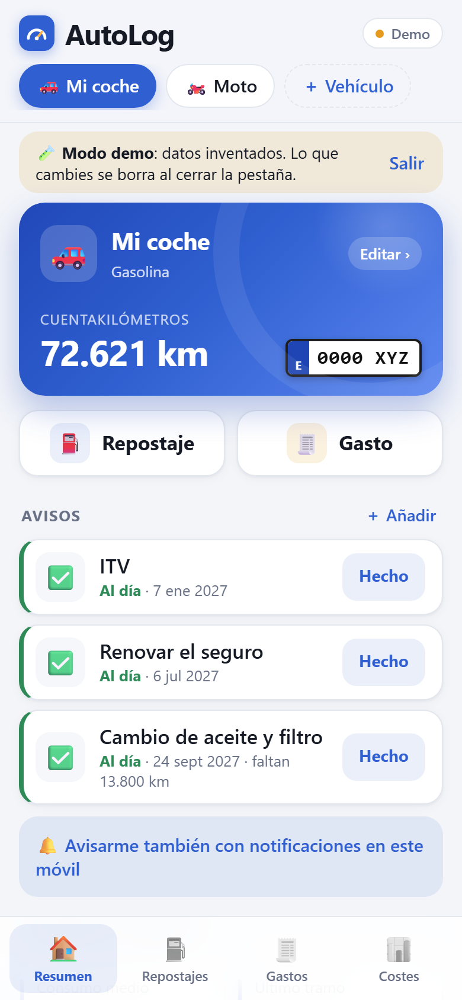
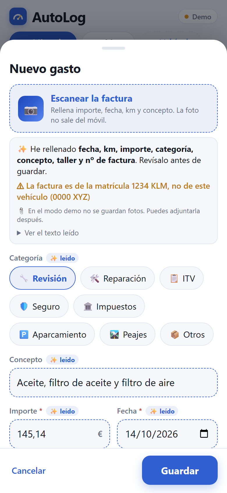
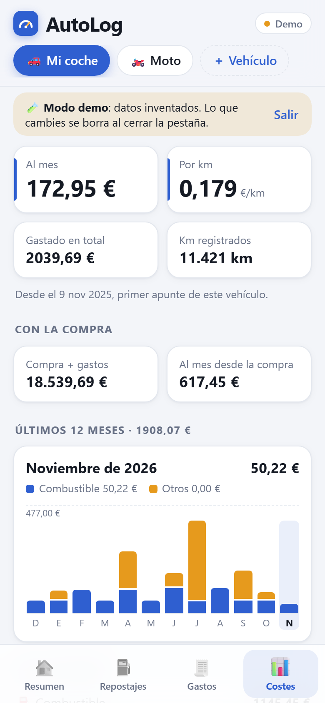
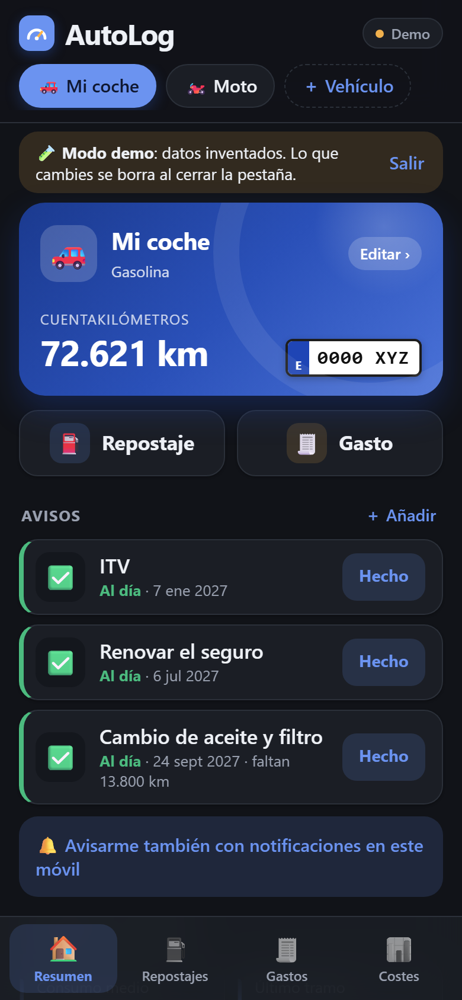

# AutoLog — el historial de tu vehículo

[English](README.md) · **Español**

Apunta los repostajes, gastos y avisos de tu coche o tu moto, y mira cuánto consume y cuánto te cuesta de verdad.
AutoLog es una web que se instala en el móvil (PWA) y que **alojas tú**: tus datos están en tu servidor, no en el de
otro.

<p align="center">
  
  
  
  
</p>

## Qué hace

- **Repostajes** con el consumo real (método lleno a lleno), €/L y coste de cada tramo.
- **Gastos** por categoría (revisión, reparación, ITV, seguro, impuestos, aparcamiento, peajes…) con fotos y PDF.
- **Avisos** por fecha y/o km (aceite, ITV, seguro…), con **notificaciones push** si quieres.
- **Costes**: al mes, por km, con el precio de compra, gráfico de 12 meses y reparto por categoría.
- **Escanear facturas y tickets**: haces la foto y se rellenan importe, fecha, km, litros y concepto. El OCR funciona
  **en el propio móvil** ([runonweb](https://runonweb.ai/models/ocr), PP-OCRv6): la foto no sale del dispositivo.
- **Sin cobertura**: los cambios se guardan en el móvil y se envían cuando vuelve la red.
- **Validación** de cada campo (km imposibles, €/L poco creíble, fechas futuras…).
- Modo claro y oscuro, instalable en Android y iPhone, varios vehículos.

## Pruébala

Arráncala en local (ver [Desarrollo](#desarrollo)) y abre `http://localhost:5173/?demo=1`: el **modo demo** enseña
datos inventados, no necesita servidor y no toca ningún dato real.

## Instala la tuya

AutoLog es **autoalojada**: cada persona monta su propia copia. No hay un servicio central y nadie más ve tus datos.

| Dónde | Guía |
|---|---|
| Tu servidor / NAS / Raspberry Pi / VPS (Docker) | [docs/es/self-hosting.md](docs/es/self-hosting.md) |
| Cualquier nube (contenedor + PostgreSQL) | [docs/es/cloud.md](docs/es/cloud.md) |

Inicio rápido con Docker:

```sh
git clone https://github.com/<owner>/autolog.git && cd autolog
cp .env.example .env          # pon AUTOLOG_TOKEN (openssl rand -hex 24) y POSTGRES_PASSWORD
docker compose up -d --build  # la app en 127.0.0.1:8791 + su propio PostgreSQL
```

Después ponle HTTPS delante (Tailscale, Caddy, Cloudflare Tunnel…): hace falta para instalarla en el móvil.

## Privacidad y seguridad

- Tus datos se quedan en **tu** PostgreSQL y en **tu** disco. La app no tiene analítica ni rastreo.
- Las únicas peticiones fuera de tu servidor son la descarga, una sola vez, del modelo del OCR (Hugging Face) y de su
  motor (jsdelivr), y las notificaciones push (a través de los servicios de Google, Apple o Mozilla, como cualquier web).
- Para entrar hace falta una clave (`AUTOLOG_TOKEN`, mínimo 16 caracteres); sin ella el servidor no arranca. Los
  intentos fallidos repetidos se bloquean, y se envían cabeceras de seguridad (CSP…).
- ¿Has encontrado una vulnerabilidad? Avisa en privado: ver [SECURITY.md](SECURITY.md).

## Cómo funciona

Consumo, avisos, costes, push, adjuntos, escáner, validación, API y copias de seguridad:
[docs/es/how-it-works.md](docs/es/how-it-works.md).

```
Móvil (PWA) ──HTTPS──▶ autolog (Node + Hono, puerto 8791) ──▶ PostgreSQL
                         └── /data/files (adjuntos)
```

- `web/` — PWA con Vue 3 + Vite. `server/` — Node 22+ y Hono: la API `/v1` y la web compilada, en un solo contenedor.

## Desarrollo

```sh
cd server && npm install && npm run dev   # :8791 — necesita PostgreSQL (DATABASE_URL en server/.env)
cd web && npm install && npm run dev      # :5173, reenvía /v1 a :8791
npm test                                  # en web/ y en server/
```

En desarrollo puedes poner `ALLOW_NO_AUTH=1` en `server/.env`.

## Contribuir

Las ideas, los avisos de fallos y los pull requests son bienvenidos, en español o en inglés. Lee
[CONTRIBUTING.md](CONTRIBUTING.md) y el [Código de conducta](CODE_OF_CONDUCT.md).

## Hoja de ruta

1. **Interfaz en inglés** (i18n): se busca ayuda.
2. Importar y exportar (CSV).
3. Reglas del escáner para otros países y formatos (hoy: España, `1.234,56 €`).
4. Copias de seguridad y restauración desde la app.
5. Imagen Docker ya construida en cada versión (`ghcr.io`).

## Licencia

[MIT](LICENSE)
