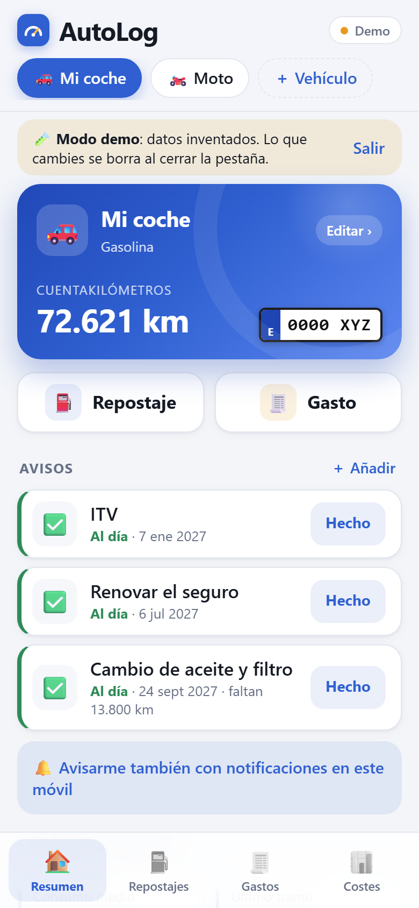
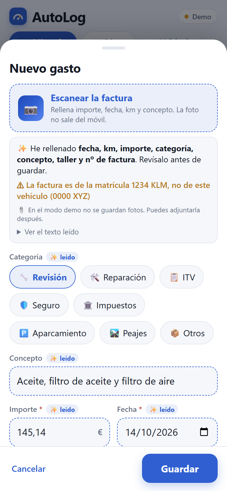
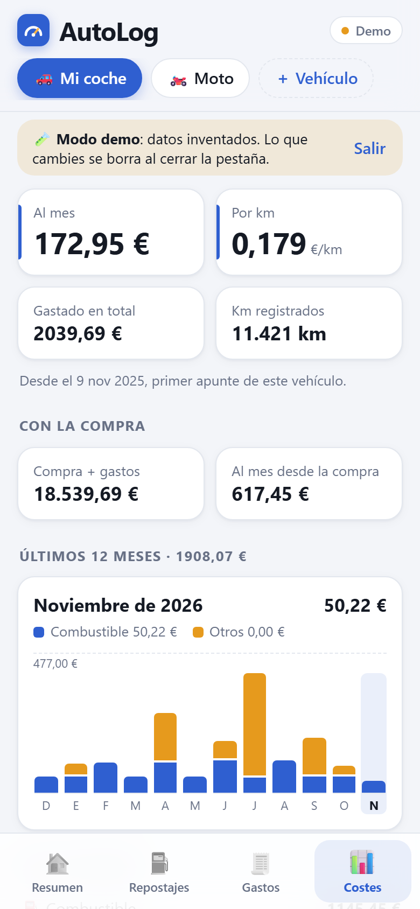
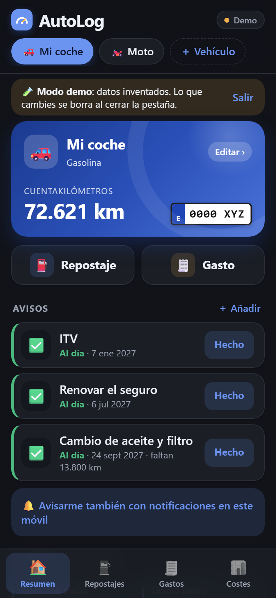

# AutoLog — el historial de tu vehículo

[English](README.md) · **Español**

[](https://davidniin.github.io/autolog/)
[](LICENSE)
[](https://buymeacoffee.com/davidniin)

Apunta los repostajes, gastos y avisos de tu coche o tu moto, y mira cuánto consume y cuánto te cuesta de verdad.
AutoLog es una app gratuita que abres en el navegador del móvil y añades a la pantalla de inicio. Úsala **ahora mismo,
sin registrarte y sin servidor** (tus datos se quedan en tu móvil), o monta tu propia copia para compartirla entre
móviles y personas. De cualquier forma, tus datos nunca están en el servidor de otro.

<p align="center">
  
  
  
  
</p>

## Empieza en 3 pasos (gratis, sin servidor)

1. **Abre [AutoLog](https://davidniin.github.io/autolog/app/) en el móvil.**
2. **Añádela a la pantalla de inicio.** Android (Chrome): menú ⋮ → *Instalar aplicación*. iPhone (Safari): Compartir ⬆︎ → *Añadir a pantalla de inicio*.
3. **Crea tu vehículo** y apunta tu primer repostaje. Ya está.

Sin cuenta, sin registrarte y sin instalar nada en un ordenador. Tus datos se quedan **solo en ese móvil**: haz una copia de
seguridad de vez en cuando (AutoLog te lo recuerda pasado un mes). Límites y detalles: [guía solo móvil](docs/es/phone-only.md).
¿Solo quieres verla? Prueba la [demo en vivo](https://davidniin.github.io/autolog/demo/) (datos inventados, no se guarda nada).

## ¿Quieres más? Elige una guía

Para usarla en **varios móviles**, compartirla con tu familia, o tener **fotos adjuntas y avisos push**, necesitas tu propia
copia en internet. Elige la que mejor te encaje (la más fácil primero):

| | Eres… | Guía |
|---|---|---|
| 🟢 | No eres técnico y solo quieres tenerla en internet | **[Un clic con Render](docs/es/one-click.md#render)**: un botón y copiar dos cosas (plan de pago) |
| 🟡 | Tienes un servidor en casa con CasaOS o Umbrel, o usas Coolify | **[Apps de un clic](docs/es/one-click.md)** |
| 🟠 | Tienes una Raspberry Pi, un NAS o un PC, o quieres tu propio dominio | **[Tu propio servidor](docs/es/self-hosting.md)** (Docker) |
| 🔴 | Usas una plataforma en la nube (Fly.io, Railway, Cloud Run…) | **[Nube](docs/es/cloud.md)** |

[](https://render.com/deploy?repo=https://github.com/davidniin/autolog)

Puedes empezar en el móvil y subir de nivel después: exporta una copia en ⚙ Ajustes e impórtala en la nueva instalación.

<details>
<summary>Inicio rápido con Docker (para quien sabe de esto)</summary>

```sh
git clone https://github.com/davidniin/autolog.git && cd autolog
cp .env.example .env          # pon AUTOLOG_TOKEN (openssl rand -hex 24) y POSTGRES_PASSWORD
docker compose up -d --build  # la app en 127.0.0.1:8791 + su propio PostgreSQL
```

Después ponle HTTPS delante (Tailscale, Caddy, Cloudflare Tunnel…): hace falta para instalarla en el móvil.
</details>

## Qué hace

- **Repostajes y recargas** con el consumo real (lleno a lleno): gasolina, diésel, GLP, **eléctricos e híbridos
  enchufables** (kWh).
- **Gastos** por categoría (revisión, reparación, ITV, seguro, impuestos, aparcamiento, peajes…) con fotos y PDF.
- **Avisos** por fecha y/o km (aceite, ITV, seguro…), con **notificaciones push** y **calendario** para Google, Apple
  u Outlook.
- **Neumáticos y piezas**: desgaste por km y por tiempo, e historial de lo que duró cada juego.
- **Informe del historial (PDF)** para enseñar a quien compra el mantenimiento, los km y las piezas.
- **Varias personas**: mismos datos, cada una con su clave; se ve quién apuntó cada cosa.
- **Costes**: al mes, por km, con el precio de compra, gráfico de 12 meses y reparto por categoría.
- **Escanear facturas y tickets** (foto o PDF, en español o en inglés): se rellenan importe, fecha, km, litros y
  concepto. El OCR funciona
  **en el propio móvil** ([runonweb](https://runonweb.ai/models/ocr), PP-OCRv6): la foto no sale del dispositivo.
- **Sin cobertura**: los cambios se guardan en el móvil y se envían cuando vuelve la red.
- **Validación** de cada campo (km imposibles, €/L poco creíble, fechas futuras…).
- **Tus unidades**: km o millas, litros o galones, L/100 km, km/L o mpg, y cualquier moneda.
- **Tus datos, contigo**: copia con fotos (ZIP) y restauración, exportar/importar CSV (Excel, Google Sheets).
- **Varios móviles**: si dos móviles editan lo mismo, eliges con qué versión quedarte; no se pierde nada sin avisar.
- **Accesible**: revisada con axe-core (WCAG 2.1 AA), se usa bien con teclado y lector de pantalla.
- **Español e inglés** (según el idioma del móvil; se cambia en ⚙ Ajustes), modo claro y oscuro, instalable en
  Android y iPhone, varios vehículos.

Los adjuntos (fotos y PDF), los avisos push, el calendario y compartir entre móviles o personas necesitan tu propio
servidor; el [modo solo móvil](docs/es/phone-only.md) los deja fuera.

## Privacidad y seguridad

- Solo móvil: tus datos se quedan en el almacenamiento del propio móvil y no se envían a ningún sitio. Con tu servidor:
  en **tu** PostgreSQL y en **tu** disco. En ambos casos la app no tiene analítica ni rastreo.
- Las únicas peticiones externas son la descarga, una sola vez, del modelo del OCR (Hugging Face) y de su motor
  (jsdelivr) y, en tu servidor, las notificaciones push (a través de los servicios de Google, Apple o Mozilla, como
  cualquier web).
- En tu servidor, para entrar hace falta una clave (`AUTOLOG_TOKEN`, mínimo 16 caracteres); sin ella el servidor no
  arranca. Los intentos fallidos repetidos se bloquean, y se envían cabeceras de seguridad (CSP…).
- ¿Has encontrado una vulnerabilidad? Avisa en privado: ver [SECURITY.md](SECURITY.md).

## Cómo funciona

Consumo, avisos, costes, push, adjuntos, escáner, validación, API y copias de seguridad:
[docs/es/how-it-works.md](docs/es/how-it-works.md).

```
Móvil (PWA) ──HTTPS──▶ autolog (Node + Hono, puerto 8791) ──▶ PostgreSQL
                         └── /data/files (adjuntos)
```

- `web/` — PWA con Vue 3 + Vite. `server/` — Node 22+ y Hono: la API `/v1` y la web compilada, en un solo contenedor.
- La app solo móvil es el mismo código de `web/` compilado sin servidor (`npm run build:app`): todo queda en el
  `localStorage` del móvil.

## Desarrollo

```sh
cd server && npm install && npm run dev   # :8791 — necesita PostgreSQL (DATABASE_URL en server/.env)
cd web && npm install && npm run dev      # :5173, reenvía /v1 a :8791
npm test                                  # en web/ y en server/
cd web && npm run build:app               # la app solo móvil, sin servidor → site/dist/app/
cd web && npm run build:site              # landing + demo en vivo + app solo móvil → site/dist/
```

En desarrollo puedes poner `ALLOW_NO_AUTH=1` en `server/.env`.

## Contribuir

Las ideas, los avisos de fallos y los pull requests son bienvenidos, en español o en inglés. Lee
[CONTRIBUTING.md](CONTRIBUTING.md) y el [Código de conducta](CODE_OF_CONDUCT.md).

## Hoja de ruta

1. Más idiomas, y reglas del escáner para más países: se busca ayuda.
2. Avisos por email.
3. Integración con Home Assistant.
4. Publicar las plantillas de un clic en las tiendas oficiales de CasaOS, Umbrel y Coolify.
5. Documentación de la API (OpenAPI).
6. Fotos y adjuntos en el modo solo móvil.

## Apoya el proyecto

AutoLog es gratis y lo seguirá siendo. Si te resulta útil, puedes **[invitarme a un café ☕](https://buymeacoffee.com/davidniin)**.
¡Gracias!

## Licencia

[MIT](LICENSE)
