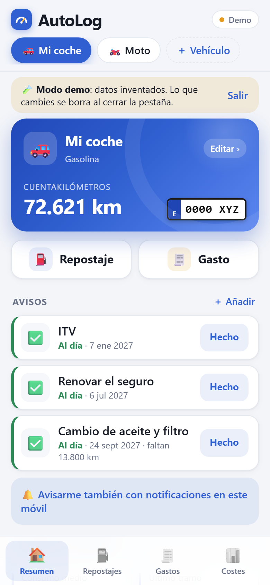
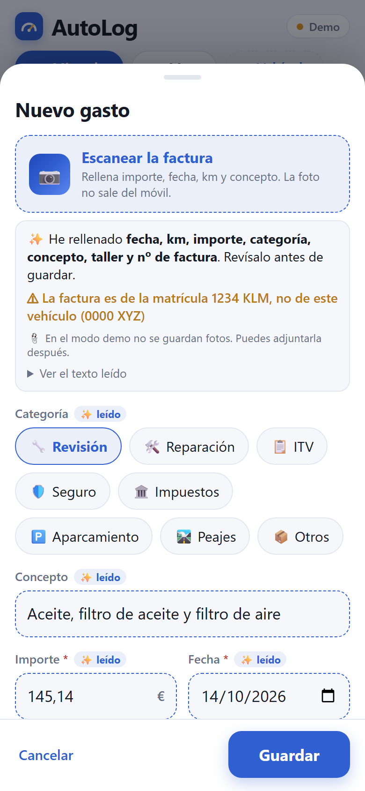
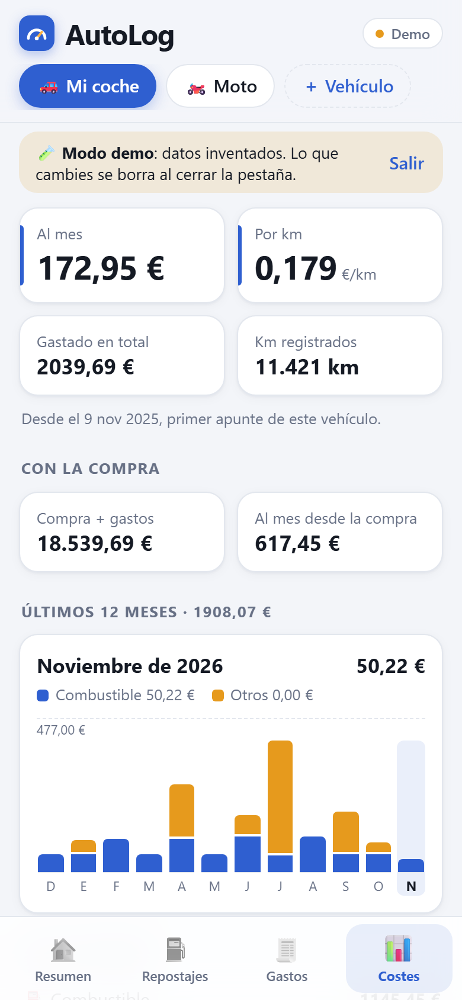
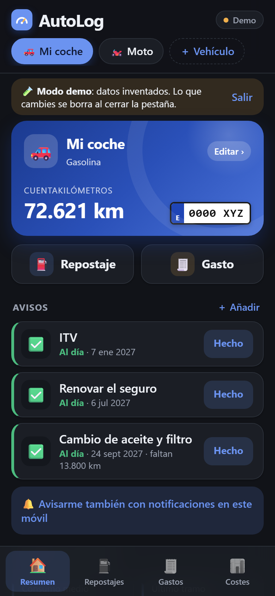

# AutoLog — your vehicle's logbook

**English** · [Español](README.es.md)

Log fill-ups, expenses and reminders for your car or motorbike, and see what it really consumes and costs.
AutoLog is a mobile web app you install on your phone (PWA) and **host yourself**: your data lives on your server,
not on someone else's.

<p align="center">
  
  
  
  
</p>

## Features

- **Fill-ups** with real consumption (full-to-full method), €/L and cost per trip.
- **Expenses** by category (service, repairs, MOT/ITV, insurance, tax, parking, tolls…) with photo/PDF attachments.
- **Reminders** by date and/or mileage (oil change, ITV, insurance…), with optional **push notifications**.
- **Costs**: per month, per km, including the purchase price, 12-month chart and breakdown by category.
- **Scan invoices and fuel receipts**: take a photo and the amount, date, mileage, litres and concept are filled in.
  OCR runs **on the phone** ([runonweb](https://runonweb.ai/models/ocr), PP-OCRv6): the photo never leaves the device.
- **Works offline**: changes are saved on the phone and synced when the connection is back.
- **Validation** of every field (impossible mileage, unrealistic €/L, future dates…).
- **English and Spanish** (follows the phone's language; switch it in ⚙ Settings), light/dark mode, installable on
  Android and iPhone, several vehicles.

## Try it

Run it locally (see [Development](#development)) and open `http://localhost:5173/?demo=1`: **demo mode** shows
made-up data, needs no server and doesn't touch any real data.

## Install your own

AutoLog is **self-hosted**: everyone runs their own copy. There is no central service and nobody else sees your data.

| Where | Guide |
|---|---|
| Your own server / NAS / Raspberry Pi / VPS (Docker) | [docs/en/self-hosting.md](docs/en/self-hosting.md) |
| Any cloud provider (container + PostgreSQL) | [docs/en/cloud.md](docs/en/cloud.md) |

Quick start with Docker:

```sh
git clone https://github.com/<owner>/autolog.git && cd autolog
cp .env.example .env          # set AUTOLOG_TOKEN (openssl rand -hex 24) and POSTGRES_PASSWORD
docker compose up -d --build  # app on 127.0.0.1:8791 + its own PostgreSQL
```

Then put HTTPS in front of it (Tailscale, Caddy, Cloudflare Tunnel…) — required to install it on the phone.

## Privacy and security

- Your data stays in **your** PostgreSQL and **your** disk. The app has no analytics and no tracking.
- The only external requests are the one-time download of the OCR model (Hugging Face) and engine (jsdelivr), and
  push notifications (sent through Google/Apple/Mozilla push services, as for any web app).
- Access needs a password (`AUTOLOG_TOKEN`, min. 16 characters); the server won't start without one. Repeated wrong
  attempts are blocked, and security headers (CSP…) are set.
- Found a vulnerability? Please report it privately: see [SECURITY.md](SECURITY.md).

## How it works

Consumption, reminders, costs, push, attachments, scanner, validation, API and backups:
[docs/en/how-it-works.md](docs/en/how-it-works.md).

```
Phone (PWA) ──HTTPS──▶ autolog (Node + Hono, port 8791) ──▶ PostgreSQL
                         └── /data/files (attachments)
```

- `web/` — Vue 3 + Vite PWA. `server/` — Node 22+ and Hono: `/v1` API plus the built web app, in one container.

## Development

```sh
cd server && npm install && npm run dev   # :8791 — needs PostgreSQL (DATABASE_URL in server/.env)
cd web && npm install && npm run dev      # :5173, proxies /v1 to :8791
npm test                                  # in web/ and in server/
```

For the server in development you can set `ALLOW_NO_AUTH=1` in `server/.env`.

## Contributing

Ideas, bug reports and pull requests are welcome, in English or Spanish. Read [CONTRIBUTING.md](CONTRIBUTING.md)
and the [Code of Conduct](CODE_OF_CONDUCT.md).

## Roadmap

1. Units and currency (miles, gallons, mpg, any currency).
2. Import/export (CSV).
3. More languages, and receipt-scanner rules for other countries (today: Spanish invoices, `1.234,56 €`) — help wanted.
4. Backups and restore from the app.
5. A prebuilt Docker image for every release (`ghcr.io`).

## License

[MIT](LICENSE)
