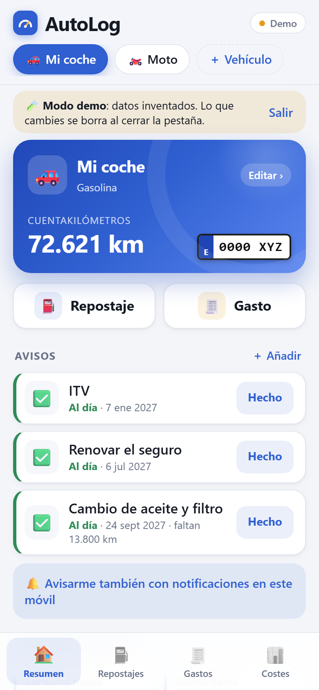
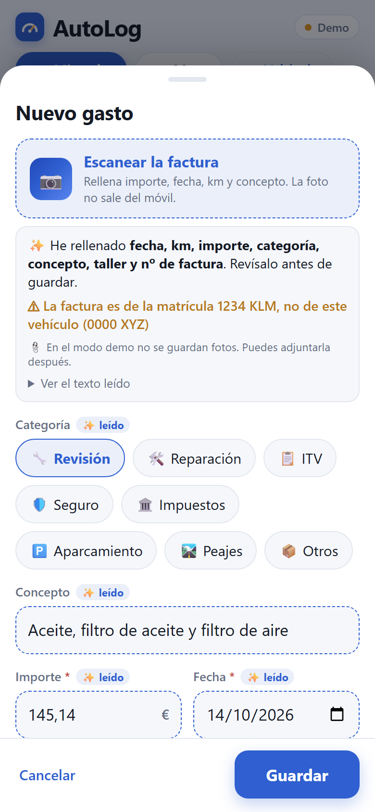
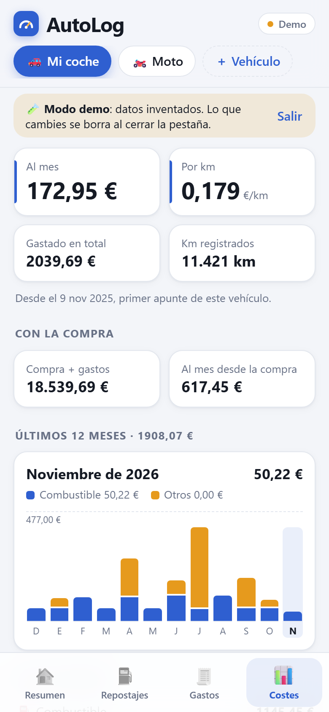
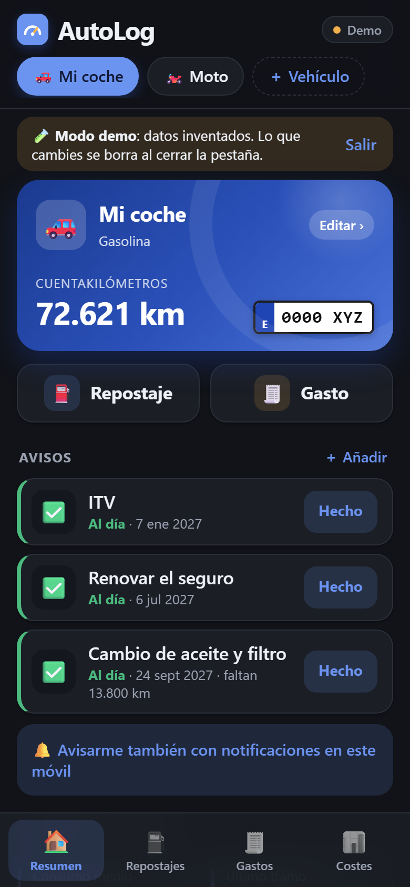

# AutoLog — your vehicle's logbook

**English** · [Español](README.es.md)

[](https://davidniin.github.io/autolog/)
[](LICENSE)
[](https://buymeacoffee.com/davidniin)

Log fill-ups, expenses and reminders for your car or motorbike, and see what it really consumes and costs.
AutoLog is a free app you open in your phone's browser and add to the home screen. Use it **right now, with no
sign-up and no server** (your data stays on your phone), or run your own copy to share it between phones and people.
Either way, your data is never on someone else's server.

<p align="center">
  
  
  
  
</p>

## Features

- **Fill-ups and charges** with real consumption (full-to-full): petrol, diesel, LPG, **electric and plug-in hybrid** (kWh).
- **Expenses** by category (service, repairs, MOT/ITV, insurance, tax, parking, tolls…) with photo/PDF attachments.
- **Reminders** by date and/or mileage (oil change, inspection, insurance…), with **push notifications** and a
  **calendar feed** for Google, Apple or Outlook.
- **Tyres and parts**: wear by distance and time, and a history of how long each set lasted.
- **History report (PDF)** to show a buyer the maintenance, mileage and parts when you sell.
- **Several people**: shared data, each with their own password; see who logged what.
- **Costs**: per month, per km, including the purchase price, 12-month chart and breakdown by category.
- **Scan invoices and fuel receipts** (photo or PDF, Spanish or English): the amount, date, mileage, litres and concept
  are filled in.
  OCR runs **on the phone** ([runonweb](https://runonweb.ai/models/ocr), PP-OCRv6): the photo never leaves the device.
- **Works offline**: changes are saved on the phone and synced when the connection is back.
- **Validation** of every field (impossible mileage, unrealistic €/L, future dates…).
- **Your units**: km or miles, litres or gallons, L/100 km, km/L or mpg, and any currency.
- **Your data, portable**: backup with photos (ZIP) and restore, CSV export/import (Excel, Google Sheets).
- **Several phones**: if two phones edit the same thing, you choose which version to keep — nothing is lost silently.
- **Accessible**: checked with axe-core (WCAG 2.1 AA), keyboard and screen-reader friendly.
- **English and Spanish** (follows the phone's language; switch it in ⚙ Settings), light/dark mode, installable on
  Android and iPhone, several vehicles.

Attachments (photos and PDFs), push reminders, the calendar feed and sharing between phones or people need your own
server; the [phone-only mode](docs/en/phone-only.md) leaves them out.

## Start now (no server)

**[Open AutoLog](https://davidniin.github.io/autolog/app/)** on your phone, then tap *Add to Home Screen* (Android:
menu ⋮ → *Install app*; iPhone: Share ⬆︎ → *Add to Home Screen*). That's it: no account, no server, nothing to install.
Your data is saved **only on that phone**, so make a backup now and then (AutoLog reminds you after a month).

The limits (one phone, no photo attachments, no push reminders) and how to move to a server later are in
[docs/en/phone-only.md](docs/en/phone-only.md).

Just curious? **[Live demo](https://davidniin.github.io/autolog/demo/)** — the real app with made-up data. Nothing is
saved and nothing is sent anywhere. Locally: run it (see [Development](#development)) and open
`http://localhost:5173/?demo=1`.

## Which way is for me?

| I want… | Choose |
|---|---|
| To use it myself, on one phone, right now | **[Phone only](docs/en/phone-only.md)** (above) |
| Several phones, my family, photos and push reminders — without typing commands | **[One click](docs/en/one-click.md)** |
| Full control on my own server, NAS or Raspberry Pi | **[Own server](docs/en/self-hosting.md)** (Docker) |

You can start on the phone and move up later: export a backup in ⚙ Settings and import it on the new setup.

## Install your own

For several phones or people, AutoLog is **self-hosted**: everyone runs their own copy. There is no central service and
nobody else sees your data.

| Where | Guide |
|---|---|
| Your own server / NAS / Raspberry Pi / VPS (Docker) | [docs/en/self-hosting.md](docs/en/self-hosting.md) |
| Any cloud provider (container + PostgreSQL) | [docs/en/cloud.md](docs/en/cloud.md) |
| **One click:** CasaOS, Umbrel, Coolify, Render | [docs/en/one-click.md](docs/en/one-click.md) |

[](https://render.com/deploy?repo=https://github.com/davidniin/autolog)

Quick start with Docker:

```sh
git clone https://github.com/davidniin/autolog.git && cd autolog
cp .env.example .env          # set AUTOLOG_TOKEN (openssl rand -hex 24) and POSTGRES_PASSWORD
docker compose up -d --build  # app on 127.0.0.1:8791 + its own PostgreSQL
```

Then put HTTPS in front of it (Tailscale, Caddy, Cloudflare Tunnel…) — required to install it on the phone.

## Privacy and security

- Phone only: your data stays in the phone's own storage and is never sent anywhere. With your own server: it stays in
  **your** PostgreSQL and **your** disk. Either way the app has no analytics and no tracking.
- The only external requests are the one-time download of the OCR model (Hugging Face) and engine (jsdelivr), and, on
  your own server, push notifications (sent through Google/Apple/Mozilla push services, as for any web app).
- On your own server, access needs a password (`AUTOLOG_TOKEN`, min. 16 characters); the server won't start without
  one. Repeated wrong attempts are blocked, and security headers (CSP…) are set.
- Found a vulnerability? Please report it privately: see [SECURITY.md](SECURITY.md).

## How it works

Consumption, reminders, costs, push, attachments, scanner, validation, API and backups:
[docs/en/how-it-works.md](docs/en/how-it-works.md).

```
Phone (PWA) ──HTTPS──▶ autolog (Node + Hono, port 8791) ──▶ PostgreSQL
                         └── /data/files (attachments)
```

- `web/` — Vue 3 + Vite PWA. `server/` — Node 22+ and Hono: `/v1` API plus the built web app, in one container.
- The phone-only app is the same `web/` code built without a server (`npm run build:app`): everything stays in the
  phone's `localStorage`.

## Development

```sh
cd server && npm install && npm run dev   # :8791 — needs PostgreSQL (DATABASE_URL in server/.env)
cd web && npm install && npm run dev      # :5173, proxies /v1 to :8791
npm test                                  # in web/ and in server/
cd web && npm run build:app               # the no-server phone app → site/dist/app/
cd web && npm run build:site              # landing page + live demo + phone app → site/dist/
```

For the server in development you can set `ALLOW_NO_AUTH=1` in `server/.env`.

## Contributing

Ideas, bug reports and pull requests are welcome, in English or Spanish. Read [CONTRIBUTING.md](CONTRIBUTING.md)
and the [Code of Conduct](CODE_OF_CONDUCT.md).

## Roadmap

1. More languages, and receipt-scanner rules for more countries — help wanted.
2. Reminders by email.
3. Home Assistant integration.
4. Publish the one-click templates in the official CasaOS, Umbrel and Coolify app stores.
5. API documentation (OpenAPI).
6. Photos and attachments in the phone-only mode.

## Support

AutoLog is free and always will be. If it's useful to you, you can
**[buy me a coffee ☕](https://buymeacoffee.com/davidniin)** — thank you!

## License

[MIT](LICENSE)
